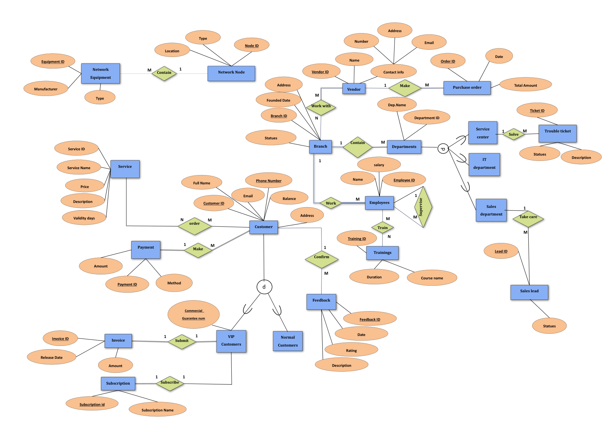
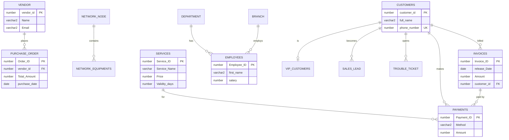

<div align="center">


# Telecom Company Database

**A complete database design for a telecommunications company: requirements, ER model and Oracle schema.**


</div>

---

## Overview

This is the final project for the **Database Systems** course (2nd year, Cyber Security, Ar-Rasheed University). It isn't an application. It's the **design work that comes before one**:

1. Gather the business requirements of a telecom operator.
2. Model them as an **Enhanced ER diagram**, with entities, relationships, cardinalities and specialization.
3. Map the ER model to a **relational schema** and implement it in **Oracle SQL**.

## The business domain

The company sells **services and subscriptions** to **customers** through **branches**, runs a **network** of nodes and equipment, buys hardware from **vendors**, and keeps **employees** trained. Customer-facing departments handle **trouble tickets** and **sales leads**.

## ER diagram



Notable modeling decisions:

| Decision | Why |
|---|---|
| **Customer → VIP / Normal** (disjoint specialization) | VIP customers carry a *commercial guarantee number* and submit invoices and subscriptions differently |
| **Department → Service Center / IT / Sales** (disjoint specialization) | Each department type owns different work: tickets, sales leads, and so on |
| **Employee *supervises* Employee** (recursive 1:M) | Models the management hierarchy without a separate table |
| **Employee ↔ Training** (M:N) | One employee takes many trainings, and each training has many attendees |
| **Customer ↔ Service** (M:N *order*) | Customers order many services, and each service has many customers |

## Relational schema



The full DDL is in [`sql/schema.sql`](sql/schema.sql) and has 16 tables.

## Repository contents

```text
telecom-company-database/
├── sql/
│   └── schema.sql                          # Oracle DDL: tables, PKs, FKs, constraints
└── docs/
    ├── requirements.pdf                    # the assignment brief
    ├── description-ar.docx                 # domain description (Arabic)
    ├── telecom-company-database-project.pdf  # ER diagram (original)
    ├── telecom-company-database-project.docx
    └── er-diagram.png                      # ER diagram rendered for this README
```

## Try it

Run the schema in **Oracle Database XE** (or [Oracle Live SQL](https://livesql.oracle.com/), which is free and runs in the browser):

```sql
@sql/schema.sql
```

## What I learned

- Turning vague business sentences into entities, attributes and cardinalities.
- When to use **specialization** instead of a type column.
- Mapping M:N relationships and recursive relationships to tables.
- **Oracle syntax is strict.** Two typos in my original DDL (`date(30)` and a trailing comma) stopped the script from running. They're fixed in a later commit.

### Known gaps (kept as designed)

- `Invoices.Subscription_id` has no foreign key to `Subscription`.
- `Feedback`, `Service Center`, `IT` and `Sales` appear in the ER diagram but were not implemented as tables.

## Author

**Humam Al-Dhubhani** · [GitHub](https://github.com/humamaldhubhani)

<sub>Released under the [MIT License](LICENSE).</sub>
